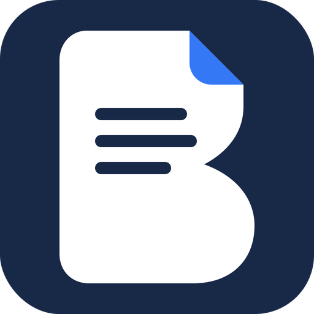

<p align="center"></p>

<p align="center"><a href="README.md">English</a> · <b>Deutsch</b> · <a href="README.fa.md">فارسی</a></p>

# Bewerbo

Eine kleine Windows-App, um den Überblick über Bewerbungen für Jobs und Ausbildungen zu behalten.

Ich habe Bewerbo für meine eigenen Bewerbungen in Deutschland gebaut: ein Ort, an dem ich sehe, wo ich mich
beworben habe, wie der Stand ist, wann ich nachhaken sollte, welche Unterlagen ich geschickt habe und wie viele
Bewerbungen pro Stelle noch offen sind. Alles bleibt auf deinem Computer in einer einzigen JSON-Datei.
Es gibt kein Konto und keinen Server.

Die App selbst ist auf Englisch.

## Funktionen

- **Alle Bewerbungen auf einen Blick.** Jede Karte zeigt Firma, Stelle, Art, Gehalt, Daten, Notizen und das
  Website-Symbol der Firma. Den Status änderst du direkt auf der Karte.
- **Eigene Arten.** Gib jeder Bewerbung eine beliebige Art, zum Beispiel Job, Ausbildung, Praktikum oder
  Werkstudent. Die Seitenleiste zeigt jede Art mit ihrer Anzahl.
- **Übersicht.** Offene Bewerbungen pro Art, dazu Vorstellungsgespräche, Zusagen, fällige Nachfragen und Absagen.
- **Suchen, filtern und sortieren** nach Art, Status, Firma, Notizen oder Ort. **Advanced filters…**, der letzte
  Eintrag im Sortiermenü, öffnet ein Fenster zum Filtern nach Stelle (mit Anzahl), Bewerbungsdatum, Ort und
  fälligen Nachfragen.
- **Dateien.** Bewerbo legt pro Firma einen Unterordner in `Dokumente\Bewerbo` an, oder in einem Ordner, den du
  in den Einstellungen wählst (zum Beispiel `Dokumente\Bewerbungen\Siemens`). Über den Files-Knopf auf jeder
  Karte siehst, öffnest, ergänzt und entfernst du die Dateien dieser Bewerbung, und du kannst Dateien auf eine
  Karte ziehen. Beim Anlegen einer Bewerbung zeigt das Formular die Dateien, mit denen sie startet: deine
  Standardunterlagen plus alles, was du hinzufügst, etwa Anschreiben und Lebenslauf für diese Firma. Entfernte
  Dateien landen im Papierkorb. **Import from folders** macht aus vorhandenen Firmenordnern Bewerbungen.
- **Details einfügen.** Kopiere einen Block wie den unten und drücke `Strg+V` im Hauptfenster, oder nutze
  **Paste details** im Formular, und Bewerbo füllt alles aus. Liegt beim Öffnen des Formulars so ein Block in
  der Zwischenablage, bietet es das Ausfüllen an. **Copy prompt** kopiert einen kurzen Prompt für einen
  Chat-Assistenten, damit er immer in diesem Format antwortet. Markdown-Aufzählungen, fette Feldnamen und
  Codeblöcke sind kein Problem.

  ```
  Company: Example GmbH
  Position: Fachinformatiker für Systemintegration
  Type: Ausbildung
  Status: Applied
  Location: Berlin
  Applied on: 2026-10-25
  Follow up on: 2026-11-08
  Salary: €1,200 / month
  Link: https://example.com/jobs/123
  Notes: Sent CV and cover letter v2.
  ```

- **Sicheres Speichern.** Jede Speicherung ersetzt die Datendatei atomar und behält die vorherige Version als
  Sicherung. Sicherungen lassen sich als JSON exportieren und importieren.
- **Helles und dunkles Design.** Folgt standardmäßig der Windows-Einstellung, oder du wählst eines in den
  Einstellungen.
- **Tastatur:** `Strg+N` legt eine Bewerbung an, `Strg+V` legt eine aus kopierten Details an, `Strg+F` springt
  zur Suche, `Esc` leert sie, `Strg+,` öffnet die Einstellungen.

## Download

Lade `Bewerbo.exe` aus dem neuesten [Release](../../releases/latest) herunter und starte sie. Es ist eine
einzelne, eigenständige Datei für 64-Bit Windows 10 und 11, es muss also nichts weiter installiert werden.
Windows zeigt eventuell eine SmartScreen-Warnung, weil die App nicht signiert ist: Klicke auf
**Weitere Informationen** und dann auf **Trotzdem ausführen**. Deine Bewerbungen werden getrennt gespeichert,
du kannst die exe also jederzeit durch eine neuere Version ersetzen.

## Daten

Bewerbungen liegen in `%LOCALAPPDATA%\Bewerbo\applications.json`, die vorherige Speicherung in
`applications.json.bak`, die Einstellungen in `settings.json` und zwischengespeicherte Website-Symbole in
`icons\`. Deine Unterlagen bleiben in den Ordnern, die du gewählt hast; die Datendatei speichert nur den Pfad
zum Ordner jeder Bewerbung. Website-Symbole werden über Googles Favicon-Dienst geladen, und dabei wird nur der
Hostname des Stellenlinks übermittelt.

## Entwicklung

Bauen aus dem Quellcode, Projektstruktur und Releases sind in der [englischen README](README.md#build-from-source)
beschrieben.

## Lizenz

[MIT](LICENSE)
